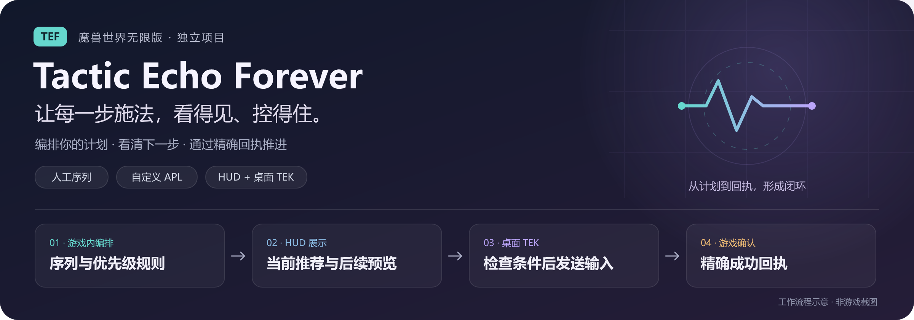

<div align="center">



**为魔兽世界无限版打造的列表循环、优先级推荐与输入联动工具。**


[功能](#主要功能) · [快速上手](#快速上手) · [技能组](#技能组) · [开发检查](#开发检查) · [更新记录](CHANGELOG.md)

</div>

## 项目介绍

Tactic Echo Forever（TEF）在游戏内编排技能、检查条件并显示推荐，通过独立的 TEF TEK 桌面程序联动现有动作栏按键。插件、桌面工具和构建脚本均位于本仓库，可独立安装和构建。

**当前基线：2.0.0。** 面向 Forever / Infinite 的职业、天赋与已学技能模型，目标客户端为公开版本 `1.60.1 / Interface 16001`，构建号用于诊断。全职业自定义主动技能可通过公开身份与施放类型接入；这不代表所有职业、技能等级和客户端接口已经逐项实测。

## 主要功能

| 功能 | 行为 |
| :--- | :--- |
| 列表循环 | 按顺序执行，最多16个父列表项；普通技能每步1～99次，支持不可用跳过、按目标／战斗限制、暂停与循环。 |
| 优先级推荐 | 从上往下选取符合条件的规则，普通技能成功后重新判断；最多16项，可插入顺序技能组。 |
| 三套独立方案 | 两种战斗来源各有三个配置槽，支持自定义名称；同一时间择一运行，默认启用方案一。 |
| 技能组 | 作为父列表的一行，组策略决定进入；组内顺序、次数、跳过与有限循环独立设置，完成后返回父列表。 |
| 增益维护 | 独立增益列表，优先于两种战斗来源；脱战需要手动开启派发，未知增益条件不会授权补放。 |
| 共享策略 | 支持使用／跳过策略，条件包括技能可用性、范围、目标距离、移动、敌人数、CDM冷却／增益、失控、战斗、目标类型、已学和成功记录；连击点条件仅盗贼显示。 |
| HUD与诊断 | 主推荐及两个候选图标、键位、范围变色、公开冷却、组内进度和阻断原因；图标大小及间距支持滑动与数值输入，启停有音效。 |
| 已有技能宏 | 可拖入有公开精确技能身份的动作栏宏，核对正文与按键后使用现有绑定；不生成或修改宏。 |
| 普通读条末尾排队 | 列表循环普通技能可选0～0.50秒提前量，受客户端排队窗口限制；不跨组入口，组内、优先级普通规则、引导及魔杖不提前预测。 |

使用策略的条件必须全部满足，任一跳过策略满足则跳过。未知不等于条件不满足，也不等于可用；对应步骤或规则保持等待或不获选。

## 快速上手

### 安装游戏插件

将仓库中的 `Tactic Echo Forever` 内层目录放到游戏插件目录，保证没有额外嵌套：

```text
无限版客户端/Interface/AddOns/Tactic Echo Forever/
├─ Tactic Echo Forever.toc
├─ Config.lua
├─ SkillGroups.lua
└─ …
```

在角色选择界面启用 Tactic Echo Forever。替换安装时先备份旧目录；只启用一个 TE／TEF 信号源。插件仅使用自己的 `TEF_DB`，不会读取其他插件设置，不修改 WTF、技能绑定或宏。

### 配置与启停

1. 输入 `/tefui` 打开TEF Studio，在派发总览选择“列表循环”或“优先级推荐”。
2. 选择编辑方案，拖入当前已学的精确技能，设置顺序、次数和策略。启用方案并点击“使用本方案”；当前方案会有明确标记。
3. 将对应技能或已有宏放到有按键的动作栏，保存配置，关闭设置。
4. 左键 HUD 主技能图标，或使用派发总览配置的启停快捷键，手动开启派发。设置窗口打开期间不发布输入。

| 命令 | 用途 |
| :--- | :--- |
| `/tefui` | 打开设置。 |
| `/tef resume` | 保留当前进度开启派发。 |
| `/tef stop` | 停止派发。 |
| `/tef toggle` | 切换派发启停。 |
| `/tef start` | 重置当前循环并重新开启。 |

普通战斗来源的输入受战斗状态及实时门禁保护。自动待命可以监听手动起手；符合当前技能组、策略和精确身份的首发可接续计数，仍须成功回执推进。仅勾选“启用增益维护”不会授予脱战维护资格，脱战维护需手动开启派发。

### 构建桌面工具

在 Windows 使用64位 Python 3.11或更新版本和 PowerShell 7，在仓库根目录执行：

```powershell
python -m pip install -r requirements-dev.txt
```

双击根目录 `TEKEXEBUILD.CMD` 进行检查与构建，成功后运行 `dist/standalone-build/TEK-TEF.exe`。桌面工具需要游戏位于前台，并保留手动输入、信号新鲜度、校验和频率等门禁。构建或启动成功不代表真实输入验收通过。

## 技能组

在两种战斗来源的技能列表点击“新建技能组”。组行的“编辑技能组”在主编辑区打开组内步骤，“编辑策略”在Inspector设置组的进入条件。

组内可拖入技能、按ID新增、拖拽／箭头排序，设置单技能策略、使用次数和不可用跳过。拖到空白处追加，拖到已有技能行时插入其前。提供保存、清空及返回；选择组内条目直接在Inspector编辑策略，返回父列表先暂存，显式保存才持久化。

每组最多8步，每步1～99次；循环轮数1～99，默认一轮，不允许嵌套。例如：

```text
父列表：A → B →【奥术组】→ D
奥术组：奥术冲击一次 → 奥术飞弹一次；循环三轮
实际：A → B → 冲击 → 飞弹 → 冲击 → 飞弹 → 冲击 → 飞弹 → D
```

组进入后保持组内顺序，普通优先级技能不抢占；成功回执推进，失败不推进。飞弹等引导在开始时可能报告成功，下一轮仍等待实际引导结束。组循环与父列表循环分别处理。

优先级中的组完成后从最高优先级重新判断，同一触发状态下不会立即反复进入；组策略明确不满足后再满足、目标选择改变或重新手动开启可重新触发。无条件组每次开启或目标选择周期执行配置轮数。

手动停止保留组进度。目标选择改变、公开死亡或消失会结束当前组；编辑、重置、重载、世界切换或致命错误清除进度。增益维护可在当前施法结束后插入，之后恢复组内位置与次数。

## 距离、增益和验证边界

- 周围敌人数按可见姓名板与物品距离探针判断，半径可选5、10、20、25、30、35、40码内；各档位不代表全部已实测。最近日志确认10码探针在一次测试有效，8码曾全部未知。不能把可见人数当作全场敌人数或实际命中数。
- HUD目标距离是估测区间；策略距离及周围敌人数使用自己的条件采样与派发前复查，HUD显示不直接授予输入资格。
- CDM活动信号不是直接光环真值。技能ID与增益目录ID可能不同；隐藏、缺失、受限或冲突均保持未知。
- 魔杖、自动攻击和自动射击保留开启状态检查；攻击6603确认开启一次后推进，不按平砍命中计数。
- 插件请求、桌面输入与游戏成功回执分别记录。离线模拟、部署哈希及历史实机记录不能代替新增路径的实际验收。

## 基线与实机验收

2.0.0将Studio工作台纳入当前基线，统一主列表、策略Inspector、技能组、已学技能库与只读追踪；修复下拉缺字和选中边框丢失，并采用部分圆角框线。保留原策略解释、触发额度、组保持条件、紧急规则及人工接管。用户已反馈上一轮主布局无明显问题；本轮视觉修正与新增路径的真实派发仍待实机复核。

建议先用单个存活敌人测试“冲击一次→飞弹一次，三轮”，保持同一目标，手动起手后观察30～60秒；确认首发不重复、引导结束后进入下一轮、完成后返回父列表。随后测试停止继续、目标变化、条件阻断及增益维护插入，使用 `/reload` 或退出游戏落盘。

| 文档 | 内容 |
| :--- | :--- |
| [2.0.0基线](docs/baselines/tef/BASELINE_2.0.0.md) | 当前行为、检查与未验证范围。 |
| [技能组说明与验收](docs/SKILL_GROUPS_DRAFT.md) | 编辑、执行和起手修复。 |
| [增益维护说明与验收](docs/BUFF_MAINTENANCE_DRAFT.md) | 增益来源、优先级及脱战维护。 |
| [策略生命周期说明](Tactic%20Echo%20Forever/docs/STRATEGY_LIFECYCLE.md) | 新选项、命令、计数与验证边界。 |
| [UI/UX开发与验收标准](docs/UI_UX_STANDARD.md) | 字体、布局、控件、交互及验收要求。 |
| [更新记录](CHANGELOG.md) | 当前与历史版本变化。 |
| [文档目录](docs/README.md) | 历史基线和实测证据。 |
| [TEF TEK说明](tek/README.md) | 桌面工具使用与构建。 |
| [项目拆分说明](docs/PROJECT_SPLIT.md) | 独立开发与来源追溯。 |

## 开发检查

在仓库根目录执行：

```powershell
python scripts/verify-baseline-contract.py --repo-root .
python "Tactic Echo Forever/tests/run.py"
python -m pytest -q tek/tests tests
python -m unittest discover -s tek/tests -q
python -m unittest discover -s "Tactic Echo Forever/tests" -q
python -m compileall -q tek/src tek/app tek/runtime
```

Lua模拟使用 `lupa.lua51`；交付前另做全部Lua文件的5.1语法检查、中文Markdown及差异格式检查。打包插件使用 `python "Tactic Echo Forever/scripts/deliver.py"`，发行包参数见 `python scripts/package-tef-release.py --help`；Windows构建脚本为 `scripts/build-tek-exe.ps1`。

TEAP命名空间为 `TEF`，保留既有v3线格式和唯一输入链；不自动同步正式服TE或替换活动TEK。当前临时 `work/` 为本机开发辅助，不属于正式发行源码。

CDM增益层数条件已移除，旧条件请在游戏内删除或更换后保存；详见[移除说明](docs/CDM_STACKS_REMOVAL.md)。

### Studio整合验收候选

当前开发包已把主列表、策略Inspector和技能组编辑整合进同一工作区，补齐精确已学技能库、条件搜索、规则复制、只读Trace和问题／输出面板。标签星号表示会话草稿尚未保存；切页与关闭不自动保存，重载前须显式保存。版本号为2.0.0，游戏内视觉与拖放体验待验收。详见[整合结果与连续验收步骤](docs/STUDIO_ACCEPTANCE_CANDIDATE.md)。

## HUD外观开发候选

当前HUD开发候选采用深蓝圆角底板、当前技能与预览分区、状态徽标、只读施法信息和固定序列步骤段。APL明确标为候选预览；布局不改变输入资格或精确回执，原启停、设置、锁定、拖动与文字配置保留。版本仍为2.0.0，游戏内视觉与交互尚待验收。

实现范围与验收步骤见[HUD改造说明](docs/HUD_STUDIO_REDESIGN.md)。

## 当前HUD精简候选

当前HUD采用260×88精简布局，统一圆角及细描边，只保留当前技能、两格预览、简短状态和进度计数。ID、来源、距离及详细信息移入主图标悬停；旧配置保留，实际字号和缩放按精简预算约束。前述大面板说明属于开发历史，当前范围以精简候选为准。游戏内视觉和交互仍待验收。
